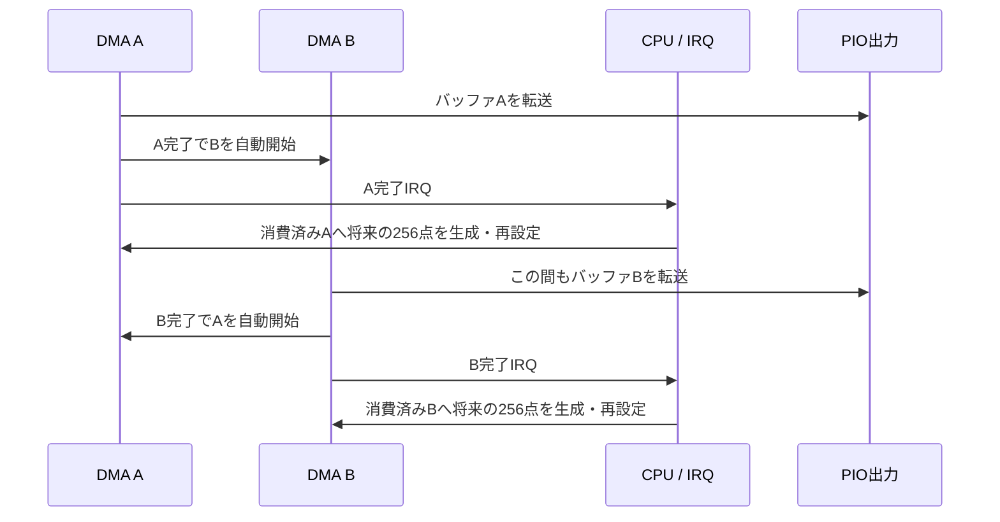

# 実装構成と時間の関係

## ハードウェアPWMは使わない

CPUが波形の切り替え時刻を計算し、DMAがデータを送り、PIOが時刻どおりに三相GPIOを更新する。RP2040のPWMペリフェラル、wrap IRQ、TOP IRQは使わない。CPUがGPIOを直接トグルするソフトウェアPWMでもない。

```mermaid
flowchart TD
    INPUT[ボタン・USB] --> MAIN[main：約10 msごとに指令を更新]
    DATA[presets.c：区間・曲線・角度係数] --> PROFILE[profiles.c：共通データ評価]
    MAIN --> PROFILE
    PROFILE --> CONTROL[control.c：DDS位相増分とV/fを計算]
    CONTROL --> VOLTAGE[voltage.c：従来SPWMのN=3だけ補正]
    VOLTAGE --> COMMAND[指令スナップショット]
    COMMAND --> IRQ[DMA完了IRQ内のCPU計算]
    IRQ --> MOD[modulator.c・programmed.c：256点分の切替時刻を生成]
    MOD --> RAM[メモリのバッファA・B]
    RAM --> DMA[DMA：PIOへ自動転送]
    DMA --> PIO[PIO：出力値を指定時間保持]
    PIO --> GPIO[GP22 U・GP21 V・GP20 W]
    GPIO --> DRIVER[外部ドライバ：相補出力とデッドタイム]
    DMA -. バッファ転送完了：約2.56 msごと .-> IRQ
```

## 混同しやすい4つの周波数

| 値 | 標準設定 | 意味 |
|---|---:|---|
| 基本波f1 | 0～110 Hz | 三相の正弦波指令の周波数。音再現時の走行進行に相当 |
| キャリアfc | プリセットによる | 三角波の周波数。同期時はfc=N×f1 |
| 制御点の計算レートFs | 100,000点/s | 基本波と三角波を10 µs刻みで評価し、交点を補間する密度 |
| 波形生成用DMA完了IRQ | 平均390.625回/s | 256点分の空きバッファを補充する頻度 |

PIOのクロック125 MHz（8 ns刻み）はキャリア周波数でも計算レートでもない。1出力区間を表すPIOデータの消費周期は可変で、継続時間としてデータ内に入っている。

## 「割り込み位数」との対応

基本波1周期あたりのDMA割り込み回数として数えるなら、

`IRQ回数/基本波周期 = Fs / 256 / f1 = 390.625 / f1`

制御点数は `Fs/f1`。同期パルス比Nとは別である。

| f1 | IRQ回数/基本波周期 | 計算点数/基本波周期 |
|---:|---:|---:|
| 10 Hz | 約39.06 | 10,000 |
| 50 Hz | 約7.81 | 2,000 |
| 100 Hz | 約3.91 | 1,000 |

通常SPWMのN=3やN=9は基本波1周期あたりの三角波キャリア周期数であり、IRQ回数ではない。新しい広域3/1パルスは直接スイッチング角を生成する方式で、別の三角波キャリアはない。パルス名Nとfc/f1を同一視しない。0 Hzでは基本波周期が定義できないためこの割り算は使わない。停止中もゼロ出力のバッファを流し、IRQは動作する。

ここで390.625回/sは波形生成用DMA IRQだけの値。USBやSDKのタイマーなど、システム全体の割り込み数ではない。また100 kHzのフィードバック制御やADCサンプリングは行っていない。

## A/B交互処理



1バッファは256×10 µs=2.56 ms分。CPUが10 µsごとに起きるのではなく、IRQ内で将来の2.56 ms分をまとめて計算する。3ピン値と保持時間のワード列を作り、PIOは既に用意された列を実行する。

DMAはFIFOへ先読みするので、完了IRQは最終GPIOエッジが出終わった瞬間とは一致しない。バッファ切り替えが平均2.56 msごとであることは変わらないが、実際のIRQ間隔と使える処理余裕にはFIFOの先読みが影響する。転送ワード数はパルスの交点数により変動する。

入力指令の反映には生成済みのキューによる数msの遅れがあり、ボタンの読み取り間隔約10 msも別に加わる。音再現向けのオープンループ生成であり、電流制御の高速応答はこの設計の対象外。

## sync3_referenceは何か

`src/control/voltage.c`内の`sync3_reference[33]`は **同期N=3専用の逆ゲイン表**。正弦波のサインテーブルでも、音階表でも、GPIOパルス列でもない。

```text
所望基本波電圧率m_cmd
       ↓ 33点の間を線形補間（N=3のみ）
比較器に入れる正弦波振幅率m_ref
       ↓ 正弦波と三角波の交点を計算
出力基本波がm_cmdへ近づく
```

低いキャリア比では、比較器の正弦波振幅と出力の基本波振幅は比例するとは限らない。今回のN=3・キャリア規定位相0xC0000000ではm_ref=1で正規化基本波が約1.27となる。そのままV/f値を入れると大きすぎるため、逆算して小さいm_refを使う。

表の添字iは所望基本波電圧率i/32（0,1/32,…,1）に対応する。値は必要な比較器振幅をQ15整数で表したもの。要求値は0～32767に制限し、上位ビットで隣り合う2点を選び、下位10 bitで線形補間する。Q15の丸めにより端点に約1 LSBの差がある。

| m_cmd | 使用するm_refの例 |
|---:|---:|
| 0.55 | 約0.46944 |
| 1.00 | 約0.79937 |

`tools/generate_sync3_table.c`は実際の変調器の論理波形を生成し、U-Vの基本波を積分して、目標振幅になるm_refを二分探索する。100 Hz・125 MHz・Fs=100 kHzで33点を生成した数値モデルの校正表であり、規格値や実車メーカーのデータではない。以前の実測では55/100 Hzで補正効果を確認した。

N=3以外ではこの表を使わない。新しいJR/PMSM公開プリセットの広域3パルスは別の角度方式なのでこの表を使わない。同じ正弦波比較・同期位相を使うN=3区間なら共用できるが、第三高調波注入、空間ベクトル、異なる同期位相、専用パルスパターンに変更する場合は流用せず再校正する。モーターの電流・トルク・音量を一定にする補正でもない。
